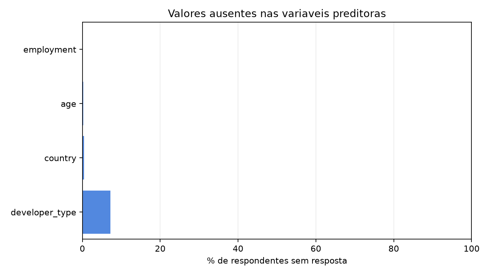
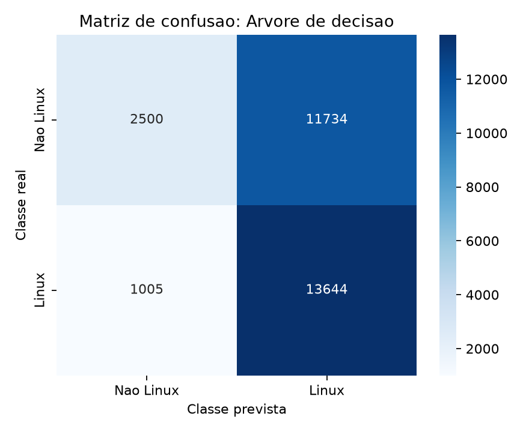

# Avaliacao do modelo de classificacao

## Pergunta de modelagem

E possivel classificar se um respondente selecionou Linux a partir de suas respostas de perfil no survey?
O modelo identifica associacoes preditivas e nao estima efeito causal.

## Preparacao e desenho da avaliacao

- Cada observacao e um respondente com ao menos uma resposta valida de sistema operacional.
- O alvo e binario: Linux (1) se qualquer resposta normalizada pertence a familia Linux; caso contrario, nao Linux (0).
- Respondentes sem resposta valida de sistema operacional excluidos: 51134.
- Variaveis preditoras: country, age, employment, developer_type.
- Experiencia profissional foi excluida porque a coluna mudou de `YearsCodePro` para `WorkExp` em 2025 e nao e diretamente comparavel entre treino e teste.
- Nulos nas variaveis preditoras sao imputados como categoria `Nao informado` e categorias sao codificadas com one-hot encoding.
- Treino: anos anteriores a 2025 (197063 respondentes).
- Teste temporal: 2025 (28883 respondentes), mantido fora do treino.
- O ano nao e usado como preditor. A divisao temporal testa generalizacao para um survey posterior.

## Dados ausentes

| Variavel | Ausentes | Percentual |
| --- | ---: | ---: |
| country | 909 | 0.40% |
| age | 645 | 0.29% |
| employment | 78 | 0.03% |
| developer_type | 16271 | 7.20% |

## Balanceamento do alvo

- Treino — nao Linux: 54.53%; Linux: 45.47%.
- Teste — nao Linux: 49.28%; Linux: 50.72%.
- Nao foi aplicado reamostragem ou peso de classe: a distribuicao deve ser julgada pelos percentuais reportados, e as metricas incluem acuracia balanceada, precisao e recall.

## Modelos e metricas

A classe majoritaria e usada como baseline. Regressao logistica e arvore de decisao sao comparadas sobre a mesma codificacao one-hot; a arvore limita profundidade e tamanho minimo das folhas para reduzir sobreajuste. A selecao entre classificadores usa F1 para a classe Linux, com acuracia balanceada e ROC-AUC como desempate.

| Modelo | Acuracia | Acuracia balanceada | Precisao Linux | Recall Linux | F1 Linux | ROC-AUC |
| --- | ---: | ---: | ---: | ---: | ---: | ---: |
| Baseline (classe majoritaria) | 49.28% | 50.00% | 0.00% | 0.00% | 0.00% | 50.00% |
| Regressao logistica | 57.35% | 57.05% | 55.67% | 78.12% | 65.01% | 62.33% |
| Arvore de decisao | 55.89% | 55.35% | 53.76% | 93.14% | 68.17% | 58.45% |

Modelo selecionado: **Arvore de decisao** (F1 Linux = 68.17%).

## Interpretacao e limitacoes

No teste temporal, o modelo selecionado obteve acuracia balanceada de 55.35% e ROC-AUC de 58.45%. Esse desempenho indica sinal preditivo limitado/modesto, e deve ser comparado com a prevalencia da classe, nao apresentado como previsao de alta confiabilidade.

Os resultados descrevem capacidade preditiva para respondentes do survey e nao demonstram que perfil profissional ou demografico cause uso de Linux. Os surveys nao acompanham a mesma pessoa entre anos, e mudancas de schema, amostragem e contexto podem reduzir a generalizacao para outros anos ou populacoes.

Relatorio gerado por `python src/train_model.py` a partir do DuckDB local.
